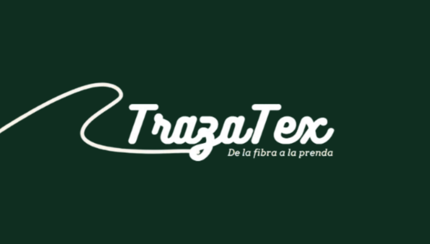

# TrazaTex Production

<p align="center">
  
</p>

TrazaTex es una plataforma web de trazabilidad textil B2B que permite seguir los materiales desde la fibra hasta la prenda. Este repositorio contiene el microservicio Production, encargado de administrar los lotes, las operaciones de transformación y las transferencias de materiales entre empresas.

## Tecnologías


## Features

- Registro y consulta de lotes textiles con su identificador de trazabilidad.
- División de lotes y control de las cantidades de material.
- Registro de maquinaria y operaciones de transformación, incluidas mezclas de lotes.
- Control de fases operativas y validaciones para las transiciones de estado.
- Gestión de transferencias de materiales entre empresas.
- Actualización del estado de calidad recibido desde el microservicio correspondiente.
- Carga y administración de evidencias fotográficas mediante Cloudinary.
- Publicación de eventos productivos mediante Apache Kafka y Transactional Outbox.

## Ejecución

Se necesita **JDK 21**, **PostgreSQL 16** y **Apache Kafka**. La integración con otras funciones de TrazaTex también depende de los servicios correspondientes. Este repositorio incluye el microservicio y los módulos compartidos necesarios para compilarlo; el Docker Compose de toda la plataforma no está incluido.

En **Windows (PowerShell)**, configurar las variables desde la raíz del repositorio:

```powershell
$env:DB_URL = "jdbc:postgresql://localhost:5432/production_db"
$env:DB_USER = "TU_USUARIO"
$env:DB_PASSWORD = "TU_CONTRASENA"
$env:KAFKA_BOOTSTRAP_SERVERS = "localhost:9092"
.\mvnw.cmd -pl production -am clean package -DskipTests
```

En **Linux o macOS**, exportar las variables equivalentes y compilar:

```bash
./mvnw -pl production -am clean package -DskipTests
```

Iniciar el servicio:

```bash
java -jar production/target/production-0.1.0-SNAPSHOT-exec.jar
```

Production utiliza el puerto `8082` y la base `production_db`. **Flyway** ejecuta las migraciones al iniciar. Para utilizar el almacenamiento de evidencias en Cloudinary, se necesita configurar `CLOUDINARY_URL` con credenciales propias; no se incluyen credenciales en este repositorio.

Para ejecutar las pruebas:

```bash
./mvnw verify
```

En Windows, utilizar `.\mvnw.cmd verify`. Algunas pruebas requieren Docker para iniciar PostgreSQL y Kafka mediante Testcontainers.

## Desarrollo

### Elección de arquitectura

Elegí **DDD y arquitectura hexagonal** para organizar las reglas productivas sin mezclarlas con los controladores HTTP, la persistencia o la mensajería. Separé los casos de uso de lotes, maquinaria, transformaciones y transferencias para mantener las validaciones de cada operación dentro de su propio contexto.

Utilicé el patrón **State** para representar las fases de los lotes, y **Strategy y Factory Method** para organizar la lógica de transformación. Así evité concentrar las reglas de hilado, tejido y teñido en un único flujo con condiciones repetidas.

### Decisión de tecnologías

Utilicé **Java 21 y Spring Boot** para implementar las API REST, con **Spring Data JPA y PostgreSQL** para almacenar las operaciones. Elegí **Flyway** para controlar los cambios en el esquema de la base de datos.

Por otro lado, incorporé **Kafka** para comunicar los cambios productivos a otros servicios, como Traceability. El patrón **Transactional Outbox** permite registrar los eventos pendientes junto con los cambios transaccionales y publicarlos posteriormente. Para las evidencias fotográficas integré **Cloudinary**, mientras que Resilience4j se utiliza en las integraciones externas configuradas.

### Construcción del software

Desarrollé operaciones para registrar y dividir lotes, administrar maquinaria, iniciar y completar transformaciones y realizar transferencias. También incorporé validaciones para controlar los materiales disponibles, la composición de las mezclas y las transiciones de estado.

Organicé la persistencia mediante adaptadores JPA y JDBC, y preparé consumidores para actualizar información relacionada con empresas y calidad. Incluí pruebas con **JUnit 5, Testcontainers, Cucumber, WireMock y ArchUnit** para comprobar reglas de negocio, integraciones y restricciones de la organización del código.

### Integración con TrazaTex

Production es responsable de las operaciones productivas y mantiene sus datos en `production_db`. Publica acontecimientos que otros microservicios consumen para actualizar la genealogía y el estado de la cadena textil, sin compartir directamente su base de datos. En el entorno completo, se ejecuta como un servicio separado junto con Kafka, PostgreSQL y el API Gateway.

### Despliegue en AWS

TrazaTex se desplegó en infraestructura de **AWS** mediante **Docker y Docker Compose**. Production funciona como un microservicio separado, conectado a su base de datos **PostgreSQL** y a **Apache Kafka** para publicar y consumir acontecimientos del proceso productivo. **Nginx** y el API Gateway canalizan las solicitudes de la aplicación hacia los servicios de negocio.

Este repositorio conserva el código y los módulos necesarios para compilar Production. La orquestación y configuración del resto de la plataforma corresponden al entorno de despliegue completo.
